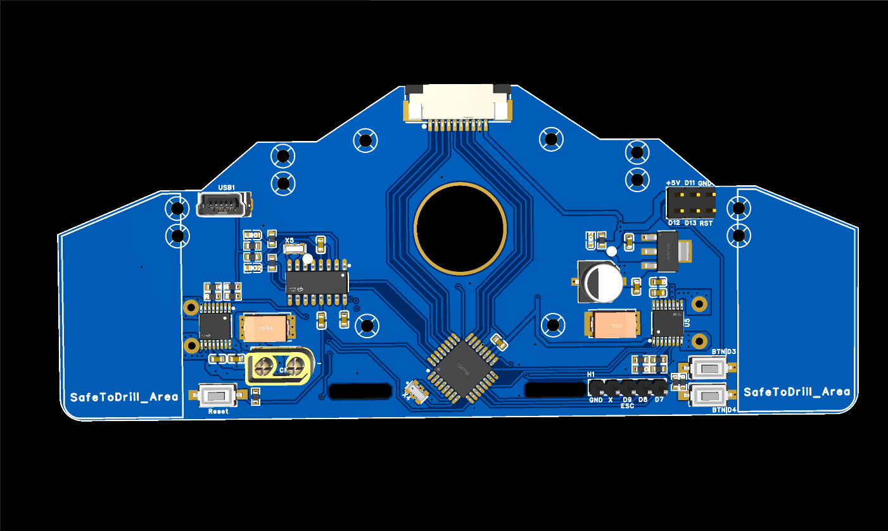

# LazyDragon Kairos — Line Follower Controller



The **LazyDragon Kairos** is a complete line-follower controller on a single
board: an Arduino-compatible **ATmega328P**, **USB programming**, a **2-3S LiPo**
input, and **two DRV8874 motor drivers** with integrated current sensing — the
whole robot controller on one PCB.


This page covers the hardware at a glance. For the board details see
[`MANUAL.md`](MANUAL.md); for troubleshooting see [`DEBUG.md`](DEBUG.md).

---

## Overview

Kairos is the "brain + muscles" board of a line-following robot. The ATmega328P
runs the control loop, the CH340G provides USB-serial for programming and
telemetry, and two DRV8874 H-bridges drive the left and right motors. A 10-pin
FPC brings in eight analog inputs (`A0..A7`), and the board is shaped to bolt to
a chassis — it has a large central hole, twelve M2 mounting holes, and snap-off
`SafeToDrill_Area` wings for fitting a frame.

Power comes from a **2-3S LiPo** through an **XT30** connector. The battery
voltage feeds the motor drivers directly while an **LM7805** regulates a 5 V
rail for the MCU and logic.

---

## Highlights

- **One-board controller.** MCU, USB, power regulation, and dual motor drivers
  on a single PCB — no separate driver boards or regulator modules.
- **Arduino-compatible.** ATmega328P at 16 MHz, programmed over USB via the
  CH340G; use the standard Arduino ATmega328P board target.
- **Dual DRV8874 drivers.** Two independent H-bridges, 4.5–37 V, 6 A peak each,
  with **integrated current sensing** (`IPROPI`) for stall/load detection.
- **2-3S LiPo input.** XT30 power connector; onboard LM7805 5 V regulator.
- **Analog input connector.** A 10-pin 1.0 mm FPC carries `A0..A7`, `+5 V`, and
  GND.
- **Chassis-mount form factor.** Central pivot hole, 12 M2 mounting holes, and
  trim-to-fit wings.
- **User controls & feedback.** Reset plus two user buttons (`D3`/`D4`) and
  power / TX / RX LEDs.

---

## Specifications

| Spec | Value |
|------|-------|
| MCU | ATmega328P-AU (Arduino-compatible) |
| MCU clock | 16 MHz crystal |
| USB-serial | CH340G + mini-USB (12 MHz crystal) |
| Motor drivers | 2x DRV8874PWPR (HTSSOP-16, one per motor) |
| Driver supply range | 4.5 V .. 37 V |
| Driver peak current | 6 A per channel |
| Driver on-resistance | 200 mΩ (high-side + low-side) |
| Driver control mode | PH/EN |
| Current sense | Integrated (`IPROPI` proportional output) |
| Power input | 2-3S LiPo via XT30 (`CN1`) |
| 5 V regulator | LM7805 (up to 1.5 A) |
| Analog inputs | 10-pin 1.0 mm FPC (`FPC1`), `A0..A7` + `+5 V` + GND |
| User buttons | 2 (`D3`, `D4`) + reset |
| Headers | `H1` (5-pin), `H5` (2x3 ICSP) |
| Indicators | power, TX, RX LEDs |
| Board size | 130.2 mm x 54.1 mm |
| Mounting | 12x M2 holes + central chassis hole |

Mechanical drawings, assembly images, the schematic, the BOM, and the
manufacturing package are in `assets/`, `datasheets/`, and `fabrication/`.

---

## Repository structure

```
Kairos/
├── README.md
├── MANUAL.md
├── DEBUG.md
├── CHANGELOG.md
├── LICENSE            # hardware — CC BY-NC-SA 4.0
├── LICENSE-CODE       # firmware — PolyForm Noncommercial 1.0.0
├── COMMERCIAL-LICENSE.md
├── assets/            # images, schematic, BOM
├── datasheets/        # vendor datasheets
├── fabrication/       # gerbers, drill, pick-and-place
└── code/              # firmware / source
```

---

## Getting started

### Hardware

1. Connect a **2-3S LiPo** to the `XT30` connector (`CN1`).
2. Connect the analog inputs to the **10-pin FPC** (`FPC1`).
3. Wire the left/right motors to the **`MotorA`** / **`MotorB`** terminals.
4. Connect a **mini-USB** cable for programming and serial telemetry.

### Software

> **TODO:** firmware is not yet published — `code/` is currently empty.

1. Install the CH340 USB driver, then select the Arduino **ATmega328P** board
   target at 16 MHz.
2. Flash a line-follower sketch that reads the analog inputs and drives the two
   DRV8874 channels (see **Pinout / wiring**).

---

## Usage / configuration

Motors are driven in **PH/EN** mode: the `EN/IN1` pin takes a PWM duty for
speed, and `PH/IN2` selects direction.

| Signal | Motor A (U6) | Motor B (U5) |
|--------|--------------|--------------|
| `EN/IN1` (PWM) | `PWMA` / `D5` | `PWMB` / `D6` |
| `PH/IN2` (DIR) | `DIRA` / `D3` | `DIRB` / `D4` |
| `nSLEEP` | `D10` | `D10` |

Firmware configuration constants are TBD until `code/` is published.

---

## Pinout / wiring

**Analog input FPC — `FPC1` (10-pin 1.0 mm)**

| Pin | Function |
|-----|----------|
| 1..8 | `A5, A4, A3, A2, A1, A0, A7, A6` (analog inputs) |
| 9 | GND |
| 10 | +5 V |

**Motor drivers (DRV8874)**

| Signal | Motor A (U6) | Motor B (U5) |
|--------|--------------|--------------|
| PWM (`EN/IN1`) | `D5` | `D6` |
| Direction (`PH/IN2`) | `D3` | `D4` |
| Sleep (`nSLEEP`) | `D10` | `D10` |

**Other connectors**

| Connector | Signals |
|-----------|---------|
| `CN1` (XT30) | LiPo `+` / `-` |
| `H1` (5-pin) | GND, spare (not connected), `D9`, `D8`, `D7` |
| `H5` (2x3) | ICSP (`MISO`, `VCC`, `SCK`, `MOSI`, `RESET`, GND) |
| `SW1` | Reset |
| `SW2` / `SW3` | User buttons `D4` / `D3` |

---

## Documentation

- [`MANUAL.md`](MANUAL.md) — usage and code/function reference.
- [`DEBUG.md`](DEBUG.md) — expected behavior and troubleshooting.
- [`CHANGELOG.md`](CHANGELOG.md) — version history.
- [`COMMERCIAL-LICENSE.md`](COMMERCIAL-LICENSE.md) — commercial licensing and royalties.
- Schematic and BOM: [`assets/`](assets/)
- Manufacturing files (gerbers, drill): [`fabrication/`](fabrication/)

---

## License

This project is **source-available, not open source**.

- **Hardware** (PCB, schematic, assets) — [`LICENSE`](LICENSE) ·
  [CC BY-NC-SA 4.0](https://creativecommons.org/licenses/by-nc-sa/4.0/): free
  for personal and non-commercial use with attribution; commercial use requires
  a separate license.
- **Firmware** (`code/`) — [`LICENSE-CODE`](LICENSE-CODE) ·
  [PolyForm Noncommercial 1.0.0](https://polyformproject.org/licenses/noncommercial/1.0.0):
  free for non-commercial use.

**Commercial use requires a paid license** (royalty + attribution). See
[`COMMERCIAL-LICENSE.md`](COMMERCIAL-LICENSE.md) or contact
**contact@lazydragon.club**.

### No warranty

The design and firmware are provided **"as is", without warranty of any kind**.
LazyDragon Pvt Ltd is **not liable** for any damages arising from their use. You
use this project at your own risk; verify all safety and certification
requirements before any product use.

> These licenses are non-commercial, so this is **not** an OSI open-source or
> OSHWA-certified open-hardware release.

**Background.** LazyDragon is a startup building open hardware. This board is
one of its earlier builds — designed from scratch in high school — now released
to the community alongside newer designs. These earlier releases are published
under source-available, non-commercial licenses.
